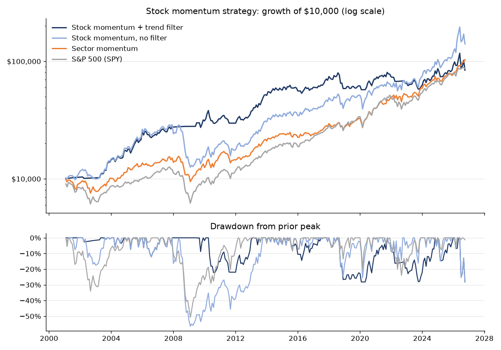

# Individual Stock Momentum Strategy

A rules-based strategy that holds the 20 S&P 500 stocks with the strongest momentum each month, steps aside into T-bills when the market trend turns down, and is tracked live with an automated monthly signal.

**Current picks:** [stock_signal.md](stock_signal.md) · **Backtest:** [stock_backtest_results.md](stock_backtest_results.md) · **Live track record:** [stock_live_log.csv](stock_live_log.csv)

This is the second of two momentum projects. The first, [sector-momentum-strategy](https://github.com/dajunk06-del/sector-momentum-strategy), rotates among sector ETFs; this one applies the same idea to individual stocks for a more aggressive version.

## The rules

At each month-end close:

1. Measure every S&P 500 stock's **12-1 momentum**: the return from 12 months ago to 1 month ago. The latest month is skipped because last month's winners tend to give some back the following month (short-term reversal).
2. Hold the top 20, 5% each, for the next month.
3. **Trend filter:** if SPY closes below its 10-month moving average, hold T-bills instead. Momentum's worst losses come in sharp rebounds after bear markets (2009 is the classic case), and this rule keeps the strategy out of the market during most of those bear markets.

Settings come from published research rather than tuning: 12-1 momentum from Jegadeesh & Titman (1993), the 10-month trend rule from Faber (2007). The backtest includes a robustness table showing results for 10, 20, 30 and 50 stocks, with and without the filter.

## Backtest

See [stock_backtest_results.md](stock_backtest_results.md) for the full table, robustness check and year-by-year returns. It compares the strategy, with and without the trend filter, against SPY and the sector momentum strategy. Results are net of a 10 bps trading cost, use dividend-adjusted prices, and avoid look-ahead bias: picks made at one month-end only earn the following month's return.

**How the backtest handles survivorship bias.** Each month it picks only from stocks that were actually in the S&P 500 at that time, using point-in-time membership data from [fja05680/sp500](https://github.com/fja05680/sp500). Testing on today's list would only include companies that survived and grew, which inflates results. One gap remains: Yahoo Finance doesn't carry prices for many delisted companies, so those can't be picked. The results file reports how much of the index had price data. A stock that stops trading while held is treated as sold flat at its last price.

## How the automation works

A GitHub Actions workflow ([.github/workflows/monthly.yml](.github/workflows/monthly.yml)) runs on the 1st of every month:

1. Downloads the current S&P 500 list and month-end prices from Yahoo Finance.
2. Ranks every stock and writes the new picks, with company names and sectors, to `stock_signal.md`.
3. Records last month's realized return vs. SPY in `stock_live_log.csv`.
4. Re-runs the backtest and updates the chart.
5. Opens an issue with the picks, which triggers an email notification.

## Files

| File | What it is |
| --- | --- |
| `stock_momentum.py` | Monthly signal and live tracking |
| `stock_backtest.py` | Backtest, robustness check and chart |
| `stock_live_log.csv` | Every live signal and its realized return |

Run it yourself: `pip install -r requirements.txt`, then `python stock_momentum.py` or `python stock_backtest.py`.

## Limitations

- About 20 positions with high monthly turnover, so trading costs and taxes matter.
- Some survivorship bias remains from delisted stocks missing in Yahoo's data.
- The trend filter can whipsaw: in choppy markets it may exit and re-enter near the same level.
- One historical period is a limited sample.

Built by Deacon Junk, finance student at Dallas Baptist University. Educational project, not investment advice.
